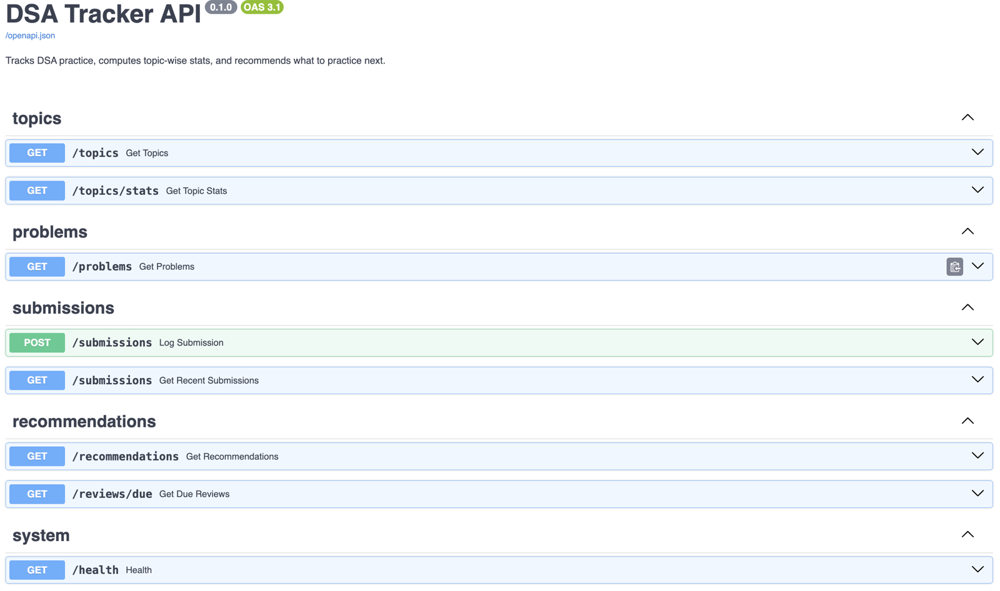
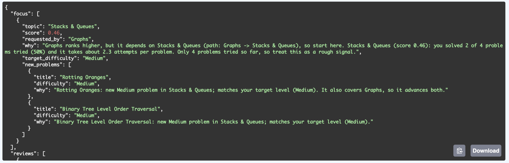

# DSA Tracker


A backend service for DSA interview preparation. It logs practice, computes topic-wise performance, and recommends what to practice next, with a plain-English reason for every recommendation.

**Stack:** Python 3.12, FastAPI, Pydantic, MySQL (PyMySQL), pytest

> **About the data.** The 72-problem catalog is a hand-curated list of common interview problems. Its difficulty labels and topic tags were assigned manually and are not LeetCode's official data. The 72 sample submissions are **synthetic**: a seeded script generated them from a built-in learner profile (strong at Arrays and Strings, weak at Graphs and Dynamic Programming), so the recommender can be checked against a known answer. Real practice is logged through the API.

## Features

- **Normalized MySQL schema** (5 tables) with foreign keys, `CHECK` constraints and `ENUM` columns, so the database itself rejects bad data.
- **Topic-wise stats:** attempted, solved, solve rate, coverage, average attempts, average time to solve, and days since last practice.
- **Rule-based recommendation engine** that finds weak topics, respects prerequisites (it will not send you to Graphs before Stacks & Queues), picks problems at a suitable difficulty, and schedules reviews with spaced repetition.
- **Explainable output:** every recommendation says why, using numbers from your own history.
- **REST API** with request validation and clean error responses (404, 422, and 503 with `Retry-After` when the database is down).
- **Data structures and algorithms written from scratch** (see [Algorithms written from scratch](#algorithms-written-from-scratch)).
- **356 tests with 100% line coverage**, run against a separate test database, plus a mutation check.

## Architecture

```text
 Client or Swagger UI
          |
          v
 FastAPI routes (app/api)
          |
          v
 Services (app/services)
 stats, scoring, recommender, revision, explain, plan
          |                       |
          v                       v
 Algorithms                     MySQL
 (app/algorithms)
```

Routes validate input with Pydantic models and call services. The services hold all the logic. The planning code is written as plain functions that take data and return a plan, with no database access, so it can be tested directly.

## Database schema

```text
topics              (topic_id, name)
problems            (problem_id, title, platform, difficulty, url)
submissions         (submission_id, problem_id, status, attempts, time_taken_min, submitted_at, notes)
problem_topics      (problem_id, topic_id)   links problems and topics (many-to-many)
topic_prerequisites (topic_id, prereq_id)    prereq_id must be learned before topic_id

problems 1 --- * submissions
problems 1 --- * problem_topics * --- 1 topics
topics   1 --- * topic_prerequisites   (twice: once as topic_id, once as prereq_id)
```

- A problem can have several topics (many-to-many through `problem_topics`).
- `topic_prerequisites` stores the prerequisite graph as edges between topics.
- Submissions are separate rows, so the same problem can be attempted many times. That is what makes spaced repetition possible.

## How the recommendations work

**1. Score every topic from 0 to 1** (higher means practice it sooner):

| Signal | Measured as | Weight |
|---|---|---|
| Low solve rate | 1 minus the smoothed solve rate | 0.45 |
| Struggle | average attempts per problem (1 scores 0, 3 or more scores 1) | 0.20 |
| Staleness | days since last practice (0 scores 0, 30 or more scores 1) | 0.20 |
| Coverage gap | share of the topic's problems not yet tried | 0.15 |

The solve rate is counted per problem (a problem counts as solved if any submission solved it) and smoothed so small samples are not over-trusted: `(solved + 0.6 x 3) / (attempted + 3)` pulls sparse data toward 60%.

**2. Skip mastered topics:** at least 3 problems tried and a score under 0.35.

**3. Follow prerequisites:** a breadth-first search over the prerequisite graph finds the nearest unmet prerequisite, and the plan recommends that topic instead, noting which topic asked for it.

**4. Pick problems:** untouched problems closest to a target difficulty, chosen from the smoothed solve rate (below 0.50 is Easy, 0.75 or above is Hard, otherwise Medium). A problem that also covers the topic that triggered a redirect goes first.

**5. Schedule reviews** from each problem's latest submission:

| Latest result | Review after |
|---|---|
| Attempted (not solved) | 2 days |
| Needs Revision | 3 days |
| Solved, 3 or more attempts | 7 days |
| Solved, 2 attempts | 14 days |
| Solved on the first try | 30 days |

The weights and thresholds are heuristics chosen by judgment, not learned from data. They are constants in `app/services/scoring.py`, `recommender.py`, `problem_picker.py` and `revision.py`.

## Algorithms written from scratch

| Algorithm | File | Where it is used |
|---|---|---|
| Merge sort (stable, with a key function) | `sorting.py` | Ranking topics, ordering suggested problems and due reviews |
| BFS (nearest unmet prerequisites) | `graph.py` | The recommender's prerequisite redirect |
| Topological sort | `graph.py` | `scripts/seed_prerequisites.py`, which rejects cyclic prerequisite data |
| Binary search (lower and upper bound, range lookup) | `search.py` | `scripts/algorithms_demo.py` (date-range lookup over submissions) |
| Hash table (chaining, resizing) | `hashing.py` | `scripts/algorithms_demo.py` (problem-title index) |
| DFS (all prerequisites of a topic) | `graph.py` | `scripts/algorithms_demo.py` |

Production code would normally use Python's built-ins. These implementations exist to show how the techniques work, and the tests compare each one against its built-in equivalent (`bisect`, `sorted`, `dict`) on randomized inputs.

## API

| Method | Path | Description |
|---|---|---|
| GET | `/health` | API and database status |
| GET | `/topics` | All topics |
| GET | `/topics/stats` | Per-topic performance |
| GET | `/problems` | Problems with topics and latest status. Filters: `topic`, `difficulty`, `status` (Solved, Attempted, Needs Revision, Untouched), `limit` (1-100), `offset` |
| GET | `/submissions` | Newest submissions first (`limit` 1-100) |
| POST | `/submissions` | Log an attempt |
| GET | `/recommendations` | Today's plan. Parameters: `focus` (1-10), `problems` (1-10), `reviews` (0-20) |
| GET | `/reviews/due` | Problems due for review (`limit` 1-100) |

Interactive docs are served at `/docs`. Errors: `404` for an unknown topic or problem, `422` for invalid input, `503` with a `Retry-After` header when the database is unreachable, and `500` for anything unexpected. Error responses never include SQL, hostnames or stack traces; those go to the server log.

Log a submission:

```bash
curl -s -X POST http://127.0.0.1:8000/submissions \
  -H "Content-Type: application/json" \
  -d '{"problem_id": 1, "status": "Solved", "attempts": 2, "time_taken_min": 35}'
```

It returns `201 Created` with the saved row. `status` must be `Solved`, `Attempted` or `Needs Revision`, `attempts` is 1 to 50, and unknown fields are rejected.

## Quick start

Requires Python 3.12 and MySQL 8 (the `CHECK` constraints need 8.0.16 or newer).

```bash
# 1. Get the code and install dependencies
git clone https://github.com/sivasaladi2006/dsa_tracker.git
cd dsa_tracker
python3 -m venv venv
source venv/bin/activate
pip install -r requirements.txt

# 2. Configure the database connection
cp .env.example .env            # then edit .env and set DB_PASSWORD

# 3. Create the database and tables (use the DB_NAME you set in .env)
mysql -u root -p -e "CREATE DATABASE IF NOT EXISTS dsa_tracker CHARACTER SET utf8mb4;"
mysql -u root -p dsa_tracker < data/schema.sql

# 4. Load the sample data
python -m scripts.seed_topics
python -m scripts.seed_prerequisites
python -m scripts.import_problems
python -m scripts.import_submissions

# 5. Run the API (interactive docs at http://127.0.0.1:8000/docs)
uvicorn app.main:app --reload

# 6. Or print today's plan in the terminal
python -m scripts.show_plan
```

## Screenshots

The interactive API docs, served at `/docs`:



A recommendation with its reasoning, from `GET /recommendations`:



## Example output

`python -m scripts.show_plan` (scores and day counts change with the date, because the sample data is fixed):

```
FOCUS TOPICS
1. Graphs ranks higher, but it depends on Stacks & Queues (path: Graphs -> Stacks & Queues), so start here. Stacks & Queues (score 0.447): you solved 2 of 4 problems tried (50%) and it takes about 2.3 attempts per problem. Only 4 problems tried so far, so treat this as a rough signal.
   New problems:
   - Rotting Oranges: new Medium problem in Stacks & Queues; matches your target level (Medium). It also covers Graphs, so it advances both.

REVIEWS DUE
- Maximum Subarray: last result was Needs Revision after 3 attempts, 88 days ago; due after 3 days, so 85 days overdue.
```

## Testing

```bash
pytest -m "not integration"                  # 214 unit tests, no database needed
pytest                                       # all 356 tests (needs MySQL)
pytest --cov=app --cov-report=term-missing   # coverage report
python -m scripts.mutation_check             # stop the dev server first
```

Integration tests build a throwaway `dsa_tracker_test` database from `data/schema.sql` and the seed scripts, so they never touch your real data. The MySQL user needs permission to create and drop databases. The mutation check makes 15 deliberate small mistakes in the code, one at a time, and confirms the tests catch each one.

## Project structure

```
app/
  main.py          FastAPI app and /health
  db.py            MySQL connection (settings come from .env)
  schemas.py       request and response models, validation rules
  errors.py        503 and 500 handlers that keep internals out of responses
  api/             routes: catalog, submissions, recommendations
  services/        stats, scoring, recommender, problem_picker, revision, explain, plan, catalog, submissions
  algorithms/      search, sorting, hashing, graph (from scratch)
data/              schema.sql, problems.csv, submissions_sample.csv
scripts/           seed and import scripts, show_plan, demos, check scripts, mutation_check
tests/             pytest suite (unit and integration)
```

## Design decisions

- **Rule-based, not machine learning.** There are only a few dozen data points per learner, so a model would overfit, and rules can be explained line by line.
- **Solve rate per problem, not per submission,** so retrying a hard problem does not make a topic look worse than it is.
- **Small-sample smoothing,** so a topic with 3 problems tried is not judged as harshly or as generously as one with 30.
- **Prerequisite-aware recommendations,** because the weakest topic is not always the right next step.
- **Constraints in the database,** not only in Python: foreign keys, `CHECK` constraints and `ENUM` columns.
- **A separate test database and a mutation check,** so passing tests actually mean something.

## Limitations

- Single user, with no authentication.
- The sample submissions are synthetic and dated July to October 2026, so "days since last practice" grows as the calendar moves.
- Weights and thresholds are heuristics. With a larger practice history they could be tuned or replaced by a model.
- One database connection per request (no connection pool).
- Problem difficulties and topic tags are curated by hand and may differ from LeetCode's.
- No front end. The API docs at `/docs` are the interface.
- Binary search, the hash table and DFS are exercised by the demo script and the tests, not by the live API.

## License

MIT. See [LICENSE](LICENSE).
